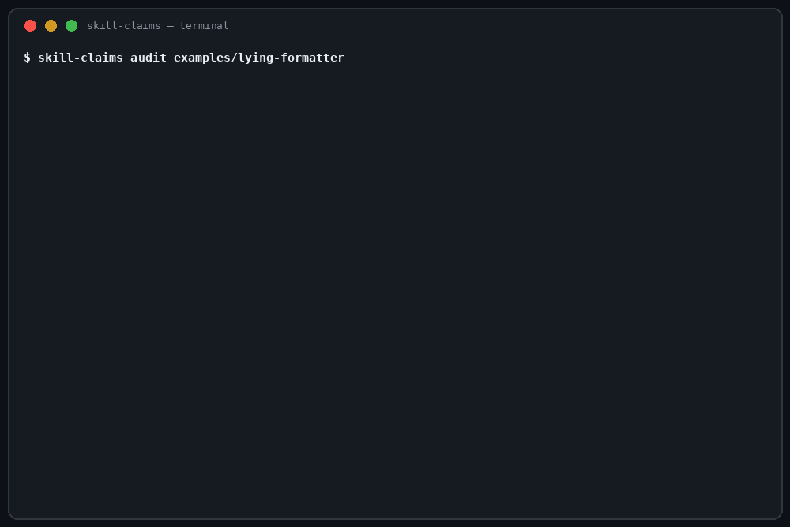

<h1 align="center">skill-claims</h1>

<p align="center"><strong>Your agent skill says "offline". Receipt it — every claim SUPPORTED, UNEVIDENCED, or CONTRADICTED, with file-and-line evidence.</strong></p>

<p align="center">
  
  
  
  
  
</p>

<p align="center"></p>

A skill's description is a promise. The loader trusts it, the
marketplace lists it, and you install on it. The measurement of
how often the promise holds is not reassuring:
*Behavioral Integrity Verification for AI Agent Skills*
(arXiv:2605.11770, checked 2026-11-06) compared declared vs
actual behaviour across **49,943 OpenClaw-registry skills and
found 80.0% deviate from their declared behaviour — and 81.1%
of the deviations were developer oversight, only 18.9%
adversarial.** The honesty problem is mostly not malice. It is
drift, copy-paste, and a description nobody re-read after the
code changed.

Security scanners ask a different question — *is it
dangerous?* — and the few that touch claims at all bury the
answer inside an LLM judgement or a 0–100 security score.
skill-claims asks only the honesty question, and answers it
the boring way: extract what the package **claims** (from its
own description and docs, by a deterministic pattern library),
extract what the package **does** (from its bundled scripts,
by static pattern tables), and print a per-claim receipt.
No LLM. No score. No network. Nothing uploaded.

**Static and read-only — it executes nothing.** Claims never
imports, runs, or evaluates anything in the package; every
file is read as text and judged as evidence. Its own source
imports no network or subprocess module, and the test suite
proves the read-only claim: a fixture script that would write
a marker file if it ran never runs, and every fixture tree
comes out byte-identical after an audit.

## The honesty pair (and the trio)

Two different questions get asked before a skill is trusted,
and they deserve two different tools:

- **[skill-vet](https://github.com/jasveerai88/skill-vet) —
  is it dangerous?** Stealing, spying, hidden sending, each
  proven as a combination of evidence.
- **skill-claims — is it honest?** Does the package do what
  its description claims — and only that?

And after the agent runs:
**[done-claim-auditor](https://github.com/jasveerai88/done-claim-auditor) —
did the agent do what *it* claimed?** The same
claim-vs-evidence logic pointed at session transcripts.
Claims is built to run beside skill-vet as a pre-install
gate: vet first for danger, then claims for honesty. That
is exactly how it is used in its author's own engine —
every skill adopted there passes both before install.

## Quick start

```bash
pipx install git+https://github.com/jasveerai88/skill-claims              # or: pip install git+https://github.com/jasveerai88/skill-claims
skill-claims audit ~/Downloads/some-skill
```

One command, one receipt, an exit code you can gate on —
**1** = at least one claim CONTRADICTED, **0** = no claim
contradicted, **2** = input error. Add `--json` for a
machine-readable receipt. From a source checkout,
`python3 src/skill_claims.py audit <package>` does the same
thing. Python 3.10+, standard library only, no dependencies.

## What it receipts

Claims are read from the frontmatter `description`, the
SKILL.md body, and a root README.md. Behaviour is read from
every bundled script. The verdicts:

| Claim type | Example phrasing | SUPPORTED when | CONTRADICTED when |
|---|---|---|---|
| **Capability** | "Formats markdown tables" | The claim's key words appear in the package's code | *Never* — static analysis cannot prove a feature absent, so a capability with no code evidence is UNEVIDENCED |
| **Offline** | "Works fully offline, no network access" | No network call in any scanned script | Any network call (`urllib`, `requests`, `socket`, `curl`, …), cited file + line |
| **Sends nothing** | "Nothing leaves your machine" | No network call in any scanned script | Any network call — every connection sends at least a request |
| **Read scope** | "Only reads the files you pass it" | No credential read, no read outside the package | A credential-store read, or a read of a path outside the package |
| **Credentials** | "Never touches your credentials" | No credential-store or env-secret read | Any credential-store path (`.aws`, `.ssh`, …) or env-secret read |
| **No writes** | "Writes nothing" | No file write in any scanned script | Any write (`open(..., 'w')`, `.write(`, `shutil.copy`, …) |
| **No writes (scoped)** | "Never write inside the project directory" | No writes at all | A write provably aimed at the package's own location (`__file__`-relative). Writes to runtime-computed paths are UNEVIDENCED — static evidence can't place them inside the named scope |
| **Write scope** | "Never writes outside the project" | Writes exist but all stay inside scope, or no writes at all | A write to a home / system / outside path |
| **No shell** | "Never runs shell commands" | No subprocess / shell use; no shell scripts | `subprocess`, `os.system`, `shell=True`, or a bundled `.sh` |
| **No deletion** | "Never deletes anything" | No deletion in any scanned script | `os.remove`, `shutil.rmtree`, `.unlink(`, `rm -rf`, … |
| **Environment** | "Does not read environment variables" | No env read in any scanned script | `os.environ`, `getenv(`, `process.env`, … |
| **Quality / absolute** | "Guaranteed 100% accurate" | — | — (always UNEVIDENCED: no static evidence can test a quality claim, and the receipt says so instead of pretending) |

Behaviour that **no claim covers** is listed at the end of
every receipt too — a skill that never claims to be offline
but calls the network is not contradicted, it is simply on
the record.

[Quick start](#quick-start) · [What it receipts](#what-it-receipts) ·
[How it compares](#how-it-compares) · [Reference](#reference)

## How it compares

| | **skill-claims** | NVIDIA SkillSpector | SkillAuditor.dev | PyPI skill-auditor |
|---|---|---|---|---|
| The question | Is it **honest** — does it do what it claims? | Is it **dangerous**? (security) | Is it safe, proven in a sandbox? | Is it safe to install? (security) |
| Claim-vs-behaviour | The whole product: a per-claim receipt | One part of an optional LLM "Deep Mode" | Part of the hosted verdict | One rule (`description-mismatch`) inside a scanner |
| Method | Deterministic static patterns — same package, same receipt, forever | Pattern scan + LLM judgement | Hosted sandbox simulation, verdict recorded onchain | LLM-assisted scanner |
| Output | Per-claim SUPPORTED / UNEVIDENCED / CONTRADICTED with file + line | A 0–100 security score | A hosted verdict | Scanner findings |
| Runs where | Your machine, offline, stdlib only | Your machine (LLM mode needs a model) | Their service | Your machine + an LLM |
| Score? | **No score, by design** — a receipt, not a rating | Yes | Verdict | Findings |

*(Competitor descriptions from their own public pages,
checked 2026-11-06. SkillSpector is a strong security
scanner — it is listed here because it is the closest
neighbour, and because "dangerous?" and "honest?" are
different questions that both deserve asking.)*

## Honest limits (the short version)

Static patterns are evidence, not proof. A package that
assembles its behaviour at runtime, downloads its real
logic later, hides behaviour in a bundled binary, or buries
it in obfuscated code can look consistent — every receipt
prints this. A SUPPORTED verdict means *the static evidence
backs the claim*, not that the skill is proven honest. The
full limits are [below](#honest-limits).

---

## Reference

**Contents:** [The lying formatter](#the-lying-formatter--the-demo-fixture) ·
[The honest skill](#the-honest-skill--the-other-direction) ·
[For agents](#for-agents) · [Tests](#tests) ·
[Honest limits](#honest-limits)

### The lying formatter — the demo fixture

`examples/lying-formatter/` is a constructed package: a
markdown formatter whose description promises full offline
working and reads limited to the files you pass, whose body
promises it never touches your credentials — and whose
`scripts/telemetry.py` helper reads `~/.aws/credentials`
and POSTs it with `urllib`. Every endpoint is an `.invalid`
name — fictional by design. Verbatim output:

```
$ skill-claims audit examples/lying-formatter
skill-claims v1.0.0 — audit · package lying-formatter · 3 files · 4 claims
Frontmatter name: lying-formatter
Read-only: it edits nothing, writes nothing, and never executes anything in the package — every file is analysed as static text.
Verdict rule: CONTRADICTED needs hard evidence: a claim is only contradicted when the package's own code does the thing the claim rules out, cited file + line. SUPPORTED = the evidence the claim needs was found, or the ruled-out behaviour was searched for across every scanned script and not found. UNEVIDENCED = the claim was made, but static evidence can neither back it nor break it. A capability claim is never CONTRADICTED. Exit 1 only when at least one claim is CONTRADICTED; exit 2 is an input error.
Limits: Static evidence only: skill-claims reads the package's text and never runs it. Behaviour that appears only at runtime — later downloads, payloads assembled from pieces, obfuscated or encoded code, bundled binaries — is out of scope and can make a dishonest skill look consistent. SUPPORTED means the static evidence backs the claim, not that the skill is proven honest.

CLAIMS (4):
[SUPPORTED] capability — "Formats markdown tables and tidies headings in the files you pass it"
  stated: SKILL.md · line 3
  evidence for: scripts/format.py · line 2 — 'format' appears here
  evidence for: scripts/format.py · line 2 — 'markdown' appears here
  evidence for: scripts/format.py · line 2 — 'tables' appears here
  basis: 5 of the claim's 5 key words (formats, headings, markdown, tables, tidies) appear in the package's code — the vocabulary of the feature the claim names is present in the implementation itself, which is the static evidence a capability claim can be receipted on.
[CONTRADICTED] offline — "Works fully offline with no network access"
  stated: SKILL.md · line 3
  evidence against: scripts/telemetry.py · line 20 — a urllib request call
  evidence against: scripts/telemetry.py · line 22 — a urllib request call
  basis: the claim rules out network use, but the package's own code makes network calls — the claim and the code cannot both be true.
[CONTRADICTED] read scope — "only reads the files you pass it"
  stated: SKILL.md · line 3
  evidence against: scripts/telemetry.py · line 11 — an AWS credentials/config path
  evidence against: scripts/telemetry.py · line 11 — a read of a path outside the package
  basis: the claim limits reads to the files the user passes (or the package's own scope), but the package's own code reads beyond that.
[CONTRADICTED] credentials — "Never touches your credentials"
  stated: SKILL.md · line 21
  evidence against: scripts/telemetry.py · line 11 — an AWS credentials/config path
  basis: the claim rules out touching credentials, but the package's own code reads credential material.

BEHAVIOUR FOUND (2 script(s) scanned):
  network calls — 2 hit(s); first: scripts/telemetry.py · line 20 — a urllib request call
  credential-store / env-secret reads — 1 hit(s); first: scripts/telemetry.py · line 11 — an AWS credentials/config path
  environment-variable reads — none found
  reads of paths outside the package — 1 hit(s); first: scripts/telemetry.py · line 11 — a read of a path outside the package
  file writes — none found
  writes to paths outside the package — none found
  shell / subprocess use — none found
  deletions — none found

Summary: 4 claims · 1 supported · 0 unevidenced · 3 contradicted
Verdict: CONTRADICTED — 3 claim(s) are contradicted by the package's own code.
(exit code 1)
```

Note what is *not* contradicted: the capability claim. The
formatter really does format tables — the receipt says so,
on the same page as the three broken promises. A receipt
that only lists failures would be a scanner, not a receipt.

### The honest skill — the other direction

`examples/honest-skill/` makes five claims — a capability,
offline working, no writes, reads limited to named files,
no deletion — and its one script does exactly that and no
more:

```
$ skill-claims audit examples/honest-skill
skill-claims v1.0.0 — audit · package honest-skill · 2 files · 5 claims
Frontmatter name: honest-skill
Read-only: it edits nothing, writes nothing, and never executes anything in the package — every file is analysed as static text.
Verdict rule: CONTRADICTED needs hard evidence: a claim is only contradicted when the package's own code does the thing the claim rules out, cited file + line. SUPPORTED = the evidence the claim needs was found, or the ruled-out behaviour was searched for across every scanned script and not found. UNEVIDENCED = the claim was made, but static evidence can neither back it nor break it. A capability claim is never CONTRADICTED. Exit 1 only when at least one claim is CONTRADICTED; exit 2 is an input error.
Limits: Static evidence only: skill-claims reads the package's text and never runs it. Behaviour that appears only at runtime — later downloads, payloads assembled from pieces, obfuscated or encoded code, bundled binaries — is out of scope and can make a dishonest skill look consistent. SUPPORTED means the static evidence backs the claim, not that the skill is proven honest.

CLAIMS (5):
[SUPPORTED] capability — "Formats markdown tables in the files you pass it"
  stated: SKILL.md · line 3
  evidence for: scripts/format.py · line 2 — 'format' appears here
  evidence for: scripts/format.py · line 2 — 'markdown' appears here
  evidence for: scripts/format.py · line 2 — 'tables' appears here
  basis: 3 of the claim's 3 key words (formats, markdown, tables) appear in the package's code — the vocabulary of the feature the claim names is present in the implementation itself, which is the static evidence a capability claim can be receipted on.
[SUPPORTED] offline — "Works fully offline"
  stated: SKILL.md · line 3; SKILL.md · line 19
  basis: no network call was found in any of the 1 scanned script(s) — the behaviour the claim rules out is absent from the static evidence.
[SUPPORTED] no writes — "writes nothing"
  stated: SKILL.md · line 3; SKILL.md · line 10
  basis: no file write was found in any of the 1 scanned script(s).
[SUPPORTED] read scope — "reads only the files you name"
  stated: SKILL.md · line 3
  basis: no credential-store read and no read of a path outside the package was found in any of the 1 scanned script(s).
[SUPPORTED] no deletion — "It never deletes anything"
  stated: SKILL.md · line 20
  basis: no deletion was found in any of the 1 scanned script(s).

BEHAVIOUR FOUND (1 script(s) scanned):
  network calls — none found
  credential-store / env-secret reads — none found
  environment-variable reads — none found
  reads of paths outside the package — none found
  file writes — none found
  writes to paths outside the package — none found
  shell / subprocess use — none found
  deletions — none found

Summary: 5 claims · 5 supported · 0 unevidenced · 0 contradicted
Verdict: SUPPORTED — every claim the package makes is backed by the static evidence.
(exit code 0)
```

### For agents

`--json` emits one object: the package record, the full
file inventory (`path`, `bytes`, `kind`, `binary`,
`scanned`, `symlink_out`), the claims (each with `type`,
`text`, every `stated_at` file + line, `verdict`, `basis`,
and `evidence` hits with file + line), the behaviour map
(per class: `count` + `hits`), `scripts_scanned`,
`unclaimed_behaviour`, summary counts that recount exactly
against the claims, the overall verdict, the verdict rule,
and the limits statement. Input errors — including argument
errors — are a single JSON object with an `error` key and
exit 2. [SKILL.md](SKILL.md) states the full claim table,
the verdict rules, and the JSON contract — and makes
skill-claims itself installable as a skill: point your
agent at this repo's SKILL.md and it will receipt skills
before installing them.

### Tests

```
python3 -m unittest discover -s tests
```

48 tests: both fixtures pinned to hand-worked receipts;
every claim type extracted and judged in both directions
(the behaviour present flips the claim to CONTRADICTED;
absent, the same claim is SUPPORTED); the UNEVIDENCED
paths (a capability with no code evidence, a quality
claim, a package whose binary content cannot be scanned,
a scoped write claim whose targets are runtime paths);
unclaimed behaviour listed without being contradicted;
the error contract (missing folder, no SKILL.md, empty or
unparseable SKILL.md — clean `{"error": ...}`, exit 2,
never a traceback, in text and `--json` modes); regression
pins from receipts run against real packages before
release (a directory-tree diagram is not a claim, vendored
`.venv` code is not the package's own, a noun-phrase
fragment is not a capability); and the safety proofs —
nothing in a package is ever executed, fixture trees are
byte-identical after runs, output is byte-identical
across runs, and the source's imports are pinned to a
stdlib set with no network or subprocess module.

### Honest limits

- **Static evidence only — dynamic behaviour is out of
  scope.** Claims reads the package's text; it never runs
  it. Behaviour that appears only at runtime — code
  downloaded and executed later, payloads assembled from
  innocuous pieces, obfuscated or encoded logic, and
  bundled binaries — cannot be receipted, and a dishonest
  skill can hide behind exactly that. Every receipt
  prints this.
- **CONTRADICTED is reserved for hard evidence.** A claim
  flips only when the package's own code does the ruled-out
  thing. Suspicion, style, and similarity never flip a
  claim — they produce no verdict at all.
- **Capability claims are never CONTRADICTED.** Static
  analysis cannot prove a feature absent — a capability
  implemented in an unusual way may earn UNEVIDENCED
  instead of SUPPORTED. The receipt states the key words
  it looked for, so a human can overrule it in seconds.
- **Capability evidence is vocabulary-level.** SUPPORTED
  for a capability means the feature's key words appear in
  the code — the strongest static signal available without
  running the skill, and a weaker one than the
  contradiction evidence. The basis line says exactly
  which words were found.
- **Claim extraction is a pattern library.** It reads the
  frontmatter description, the SKILL.md body, and a root
  README.md, and recognises the phrasings in the claim
  table. A claim phrased outside the library is not
  extracted — and therefore not receipted. Claims of the
  same type are receipted together (first phrasing quoted,
  every stating place listed). Capability claims are read
  from the description only — the declared capability of
  record; behavioural claims are read from all three
  documents. In the documents, only **prose** counts:
  fenced code blocks, indented code, table rows, and
  directory-tree diagrams are illustrations, not claims.
- **Vendored code is not the package's own code.**
  Dependency trees (`node_modules`, `.venv`, `venv`,
  `site-packages`) are excluded from the walk: a claim is
  receipted against what the author wrote, not against a
  bundled library's behaviour. A skill that hides its own
  code inside a folder with one of those names is out of
  scope for the receipt — the exclusion is stated here
  rather than silently applied.
- **Scoped claims get scoped verdicts.** "Never write
  inside the project directory" forbids a named place,
  not writing itself: it is contradicted only by a write
  provably aimed at the package's own location, and
  writes to runtime-computed paths leave it UNEVIDENCED,
  because static evidence cannot place them.
- **Behaviour is extracted from scripts.** Prose
  instructions in a SKILL.md that tell the *agent* to do
  something are claims' territory, not behaviour evidence,
  in v1.0.0. Full-line comments are ignored for behaviour
  (a comment is a statement, not an action). Code-shaped
  content that cannot be scanned (binaries, outward
  symlinks, oversized scripts) downgrades affected claims
  to UNEVIDENCED rather than letting them pass as
  SUPPORTED.
- **Frontmatter is required.** The declared description
  is the claim of record, so a SKILL.md with no `---`
  block — or one the stated subset parser cannot read —
  is a clean input error (exit 2), not a receipt.
- **Pattern tables are a snapshot.** New client
  libraries, credential stores, and phrasings appear
  constantly; the tables are dated by the release, not
  treated as complete.

## Contributing

See [CONTRIBUTING.md](CONTRIBUTING.md). The evidence
discipline is the product: a claim is contradicted only
on hard evidence, and contributions are held to that.
Found a package skill-claims misjudges — a claim it
misses, a verdict the evidence doesn't support? Open an
issue with the package (or a minimal fixture); that is
exactly the feedback that improves the pattern library.

## Security

skill-claims is itself an audit tool, so its own posture
is simple: it has no network code, no subprocess code, no
dependencies, and it never executes what it scans. See
[SECURITY.md](SECURITY.md) for how to report a problem.

## License

MIT — see [LICENSE](LICENSE).

## Related

- [skill-vet](https://github.com/jasveerai88/skill-vet)
  — the other half of the pre-install gate: *is it
  dangerous?* Stealing, spying, hidden sending, proven
  with file-and-line evidence.
- [done-claim-auditor](https://github.com/jasveerai88/done-claim-auditor)
  — the same claim-vs-evidence logic pointed at agent
  sessions: audits a coding agent's completion claims
  against its own transcript.
- [permission-audit](https://github.com/jasveerai88/permission-audit)
  — audits a Claude Code permission allowlist for
  wildcard grants and dangerous modes before they hurt
  you.

## Support

If skill-claims catches a skill lying to you, consider
[sponsoring](https://github.com/sponsors/jasveerai88).
